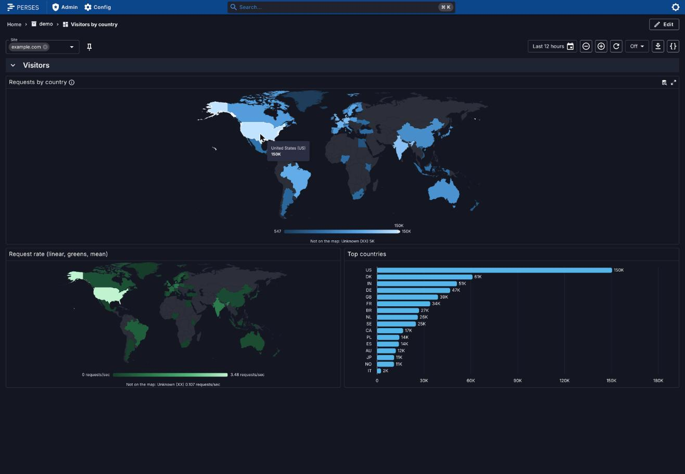
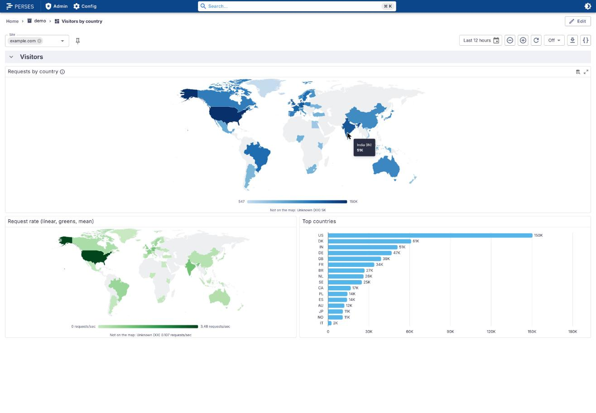
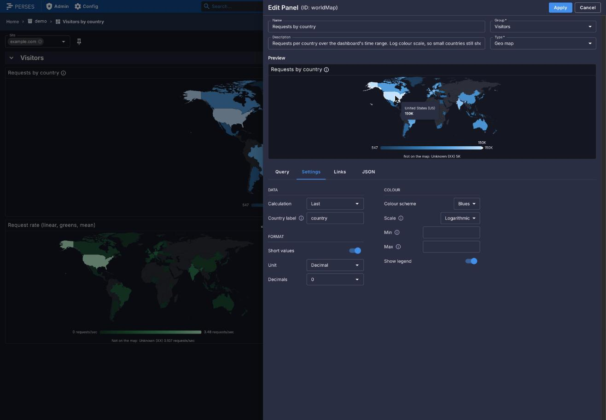

# perses-plugin-geomap

A [Perses](https://perses.dev) panel plugin, `GeoMapChart`, that draws a world map shaded by country
from a time-series query. It works with any series that carries an ISO 3166-1 alpha-2 country label:
web server or ingress metrics enriched with GeoIP, CDN edge metrics (Cloudflare, for example), or
your own application counters.

```promql
sum by (country) (increase(http_requests_total[$__range]))
```



| Light theme | Panel editor |
| --- | --- |
|  |  |

## Supported versions

| Plugin | Perses | Status |
| --- | --- | --- |
| 0.1.x | v0.54.x | Tested with v0.54.0 |

The plugin is built against `@perses-dev/*` 0.54 and `percli` v0.54.0. Other Perses minor versions may
work but are not tested; see [Why ECharts](#why-echarts) for the part most likely to break.

## What it does

- Each series is reduced to one number with a Perses calculation (`last`, `sum`, `mean`, ...). Series
  with the same country are then summed, so `sum by (country)` is optional.
- The country comes from a configurable label (default `country`). Codes are upper-cased, and `UK`/`EL`
  are mapped to `GB`/`GR`.
- A sequential colour scale (blues, greens, oranges, purples, reds, viridis) has separate ramps for light
  and dark themes. The scale is linear or log; log is the right choice for heavy-tailed traffic.
  Min and max are optional.
- Countries without data get a neutral fill, so "no traffic" and "low traffic" look different.
- The legend is a continuous colour bar with formatted values. Hovering it highlights that band.
- The tooltip shows the country name and the formatted value. Codes that have no shape (`XX` for
  unknown, `T1` for Tor exit nodes as some CDNs report them, or anything unmatched) are listed under
  the map instead of being dropped.

### Country names

Tooltips and the note under the map show `Name (CODE)`, for example `Denmark (DK)`. The name is
resolved in this order:

1. `XX` is `Unknown` and `T1` is `Tor`.
2. The map's geo data: each shape's `properties.name`, an English short name from CLDR (for example
   "United States", "South Korea", "Czechia"). `npm run world-data` bakes it in, so it is the same in
   every browser locale.
3. A `country_name` label on the series, when the query carries one, for example joined from an
   info metric such as `country_info{country, country_name}`. The query has to keep that label
   (`sum by (country, country_name)`).
4. The code alone.

### Spec

```yaml
plugin:
  kind: GeoMapChart
  spec:
    calculation: last          # required: any Perses calculation
    countryLabel: country      # label with the ISO alpha-2 code
    format: { unit: decimal, decimalPlaces: 0 }
    colorScheme: blues         # blues | greens | oranges | purples | reds | viridis
    scale: log                 # linear | log
    min: 1                     # optional fixed bounds
    max: 100000
    showLegend: true
```

The CUE schema is in `schemas/panels/geo-map-chart/`. A complete panel in a dashboard:

```yaml
panels:
  requestsByCountry:
    kind: Panel
    spec:
      display: { name: Requests by country }
      plugin:
        kind: GeoMapChart
        spec:
          calculation: last
          countryLabel: country
          colorScheme: blues
          scale: log
          showLegend: true
      queries:
        - kind: TimeSeriesQuery
          spec:
            plugin:
              kind: PrometheusTimeSeriesQuery
              spec:
                query: sum by (country) (increase(http_requests_total[$__range]))
```

## Why ECharts

Perses already ships ECharts 5.5 and shares one copy with every plugin through module federation.
Its map series covers what a choropleth needs: GeoJSON regions, `visualMap` legends, tooltips and
emphasis. So the plugin adds no charting library. Its only runtime dependency is `topojson-client`
(about 7 KB minified), which decodes the bundled TopoJSON. D3, Leaflet or MapLibre would each add far
more, and the tile-based ones need a tile server at runtime.

The map is drawn with `init` from the shared `echarts` module (see `MapCanvas.tsx`), not with Perses'
`EChart` component. That component uses Perses' own trimmed `echarts/core` build, which has no map
series and cannot see maps registered on the shared instance. This means the plugin depends on Perses
continuing to share the full `echarts` package. Re-test it on every Perses upgrade.

## Build

You need Node 22 or later, [`percli`](https://github.com/perses/perses/releases/tag/v0.54.0) v0.54.0
and [`cue`](https://cuelang.org) on `PATH` (v0.17.1 tested). `percli` uses `cue` to vendor the Perses
CUE dependencies into the archive.

```bash
npm ci
npm run lint && npm run type-check
npm run build                 # module-federation bundle in dist/
percli plugin build           # validates the schema, writes Geomap-0.1.0.tar.gz
```

`npm run dev` serves the plugin for `percli plugin start` against a running Perses. See
[CONTRIBUTING.md](CONTRIBUTING.md) for more.

### Map data

`src/data/world-countries.json` (about 220 KB) is generated. It is committed, so a normal build needs
no network. To regenerate it:

```bash
npm run world-data
```

The script takes the Natural Earth 1:50m countries from `world-atlas` and:

- keys each shape by its ISO alpha-2 code (Kosovo is `XK`; Northern Cyprus and Somaliland are drawn as
  Cyprus and Somalia)
- adds the English name
- drops Antarctica
- simplifies and quantizes the shapes

The browser never fetches map data. At runtime, rings that cross the antimeridian (Chukotka, Fiji) are
shifted so they do not streak across the map.

## Install into Perses

Perses extracts every `*.tar.gz` in `plugin.archive_paths` into `plugin.path` at startup. Setting
`archive_paths` replaces the default, so keep the directory of bundled plugins in the list. Pick one
of the three options below and restart Perses.

### Option A: release archive

Download `Geomap-<version>.tar.gz` from the
[GitHub releases](https://github.com/astrona-io/perses-plugin-geomap/releases), put it in a directory
Perses can read, and add that directory to the config:

```bash
curl -fLO https://github.com/astrona-io/perses-plugin-geomap/releases/download/v0.1.0/Geomap-0.1.0.tar.gz
```

```yaml
plugin:
  archive_paths:
    - /etc/perses/plugins-archive        # plugins bundled with Perses
    - /etc/perses/plugins-archive-extra  # put Geomap-0.1.0.tar.gz here
```

### Option B: Kubernetes image volume

The `Containerfile` packages the archive as a plugin-only OCI image (`FROM scratch`, the archive at the
image root). Build and push it to your registry:

```bash
percli plugin build
podman build -t ghcr.io/<owner>/perses-plugin-geomap:<version> .
podman push ghcr.io/<owner>/perses-plugin-geomap:<version>
```

Then mount it into the Perses pod as an
[image volume](https://kubernetes.io/docs/concepts/storage/volumes/#image) and add the mount path to
`archive_paths` as in option A. Image volumes need a cluster and container runtime that support them
(the `ImageVolume` feature; check your Kubernetes version and feature gates).

```yaml
volumes:
  - name: geomap-plugin
    image:
      reference: ghcr.io/<owner>/perses-plugin-geomap:<version>
      pullPolicy: IfNotPresent
containers:
  - name: perses
    volumeMounts:
      - name: geomap-plugin
        mountPath: /etc/perses/plugins-archive-extra
        readOnly: true
```

If the registry is private, add an `imagePullSecrets` entry to the pod as for any other image.

### Option C: custom Perses image

Copy the archive into the directory of bundled plugins. No config change is needed, because that
directory is in the default `archive_paths`:

```dockerfile
FROM persesdev/perses:v0.54.0
COPY Geomap-0.1.0.tar.gz /etc/perses/plugins-archive/
```

## Licences and credits

The plugin is Apache-2.0 (`LICENSE`). Third-party material and its notices are listed in `NOTICE`.

| What | Licence | Where |
| --- | --- | --- |
| This plugin | Apache-2.0 | `LICENSE` |
| Country shapes: [Natural Earth](https://www.naturalearthdata.com) 1:50m | Public domain | `src/data/world-countries.json` |
| [`world-atlas`](https://github.com/topojson/world-atlas) (TopoJSON conversion of Natural Earth) | ISC | build time only |
| [`topojson-client`](https://github.com/topojson/topojson-client) | ISC | bundled (runtime) |
| [`topojson-simplify`](https://github.com/topojson/topojson-simplify), [`i18n-iso-countries`](https://github.com/michaelwittig/node-i18n-iso-countries) | ISC, MIT | build time only |
| Country names (CLDR, through Node's ICU) | Unicode License v3 | baked into the map data |
| Perses shared CUE (`cue.mod/pkg`, vendored into the archive) | Apache-2.0 | archive only |

Natural Earth draws de facto boundaries. Disputed areas follow its defaults, and they are not a
political statement by this plugin.
